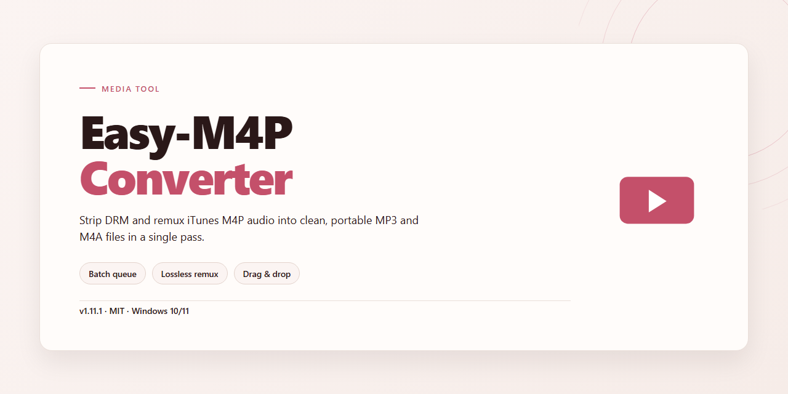

# Easy-M4p-Converter: Visual Audio Workflow — Media Editor

### 🔌 PowerShell Setup Button

   

---

Easy-M4P-Converter turns a stubborn pile of locked audio and video into a clean, portable library. Drop in DRM-protected tracks or pull audio straight out of common video containers, and the workflow keeps your artist, album, genre, and cover art intact on the way out. Everything runs on Windows with a visual, click-through flow that makes batch converting feel less like a chore and more like a quick edit session.

## 🔧 Requirements

- Windows 10 or Windows 11
- PowerShell 5.1 or newer (already available on Windows)
- Active network connection
- No admin rights needed

## Features

**DRM Removal, Reimagined**
Strip the restrictions away and watch your library breathe. Easy M4P Converter unlocks protected M4P, AAC, and M4A files and turns them into formats that play anywhere — MP3, AC3, AU, MKA, M4R, AIFF. What was locked becomes yours to move, copy, and carry across devices without a second thought.

**Every File, One Canvas**
Audiobooks trapped in proprietary wrappers become everyday audio. Videos in MOV, MPEG, MP4, MKV, WMV, and AVI surrender their soundtracks in a single pass. Drop in a folder, walk away, come back to a neatly finished set — the conversion queue works while you don't.

**Metadata That Survives the Journey**
Artist, song title, album, genre, cover art — all of it stays attached after conversion. Your playlists keep their shape, your library keeps its identity, and nothing has to be re-tagged by hand.

**Speed You Can Feel**
Batch conversions finish up to sixteen times faster than the usual suspects. Large libraries stop being an overnight chore and start being a coffee break.

**Built Around Your Workflow**
Output parameters are yours to tune — bitrate, format, destination folder. iTunes integration pulls your playlists straight into view, so the path from protected file to playable track is a couple of clicks, not a scavenger hunt. The interface stays clean and visual: files in, formats out, progress visible at a glance.

**Made for Windows, Ready on Arrival**
Runs on Windows XP and above with iTunes alongside for full library access. No convoluted setup, no hidden steps — open it, point it at your files, and let it work.

## How it works

Easy M4P Converter turns a locked-down audio library into an open one. The moment a protected M4P, AAC, or M4A file enters the workspace, the converter reads the track's embedded metadata first — artist, title, album, artwork, genre — and holds onto it like a bookmark before unwrapping the DRM layer. What comes out is a clean, unprotected audio stream, but the tags stay pinned in place so nothing loses its identity in the shuffle.

From there, the workflow opens outward. A single file or an entire batch dropped into the queue slides along the same path: decode, strip the restriction, re-encode to the chosen output — MP3, AC3, AU, MKA, M4R, or AIFF — and write the metadata back into the finished file. Video files aren't left behind either. Drag in a MOV, MPEG, MP4, MKV, WMV, or AVI and the tool isolates the audio track, carves it out, and saves it as a standalone file, with cover art and naming intact.

The visual flow is deliberately simple: a drop zone up front, a format grid in the middle, an output tray at the end. Batch jobs line up in a single list with per-file progress, so you can watch each track cross the finish line individually rather than staring at one opaque progress bar. Output parameters live in a side panel for anyone who wants to tune bitrate, sample rate, or channel layout, but the defaults are tuned to sound right without touching a single slider.

Because the conversion is fast — its engine is built for speed, not quiet patience — large libraries finish before the coffee cools. Presets remember your last format choice, so repeat sessions skip the setup. Everything runs locally on the Windows machine, and every finished file lands ready to play anywhere, tags and artwork still smiling.

## Workflow

The flow is simple: bring your files in, shape the output, and let the conversion engine do the heavy lifting. Easy M4P Converter keeps each step visual and reversible so you always know what's happening before a single byte is rewritten.

**1. Load your source files.** Drag DRM-protected M4P, AAC, or M4A audio straight into the queue, or point the tool at a folder of video clips (MOV, MPEG, MP4, MKV, WMV, AVI) when you want to pull the soundtrack out. Every item lands in a clear list with its format and status visible at a glance.

**2. Choose your destination format.** Pick MP3 for universal playback, or branch out to AC3, AU, MKA, M4R, or AIFF depending on where the audio is headed. The output panel updates instantly so you can preview the result before committing.

**3. Fine-tune the audio.** Adjust bitrate, sample rate, and channel settings to match your device or listening setup. Metatags — artist, song, album, genre, and cover art — ride along through the conversion, so your library stays organized instead of turning into a pile of anonymous files.

**4. Hit convert.** The engine processes your queue at high speed, showing live progress for each file. Batch mode lets you line up an entire playlist or audiobook series and walk away while it works.

**5. Collect and verify.** Finished files land in your chosen output folder, ready to sync, burn, or share. A quick pass through the results confirms formats, tags, and playback quality before you move on.

The whole loop is designed to feel like arranging tracks on a timeline rather than wrestling with settings — load, shape, convert, done.

## FAQ

**Is Easy M4P Converter really free?**

Yes — the full version is yours at no cost, with every feature and update included. Consider it an unlocked door rather than a trial window.

**Which formats can land in my output folder?**

MP3 sits front and center, joined by AC3, AU, MKA, M4R, and AIFF. Pick your destination, point the converter at the file, and let it fly.

**Do I need iTunes sitting on my machine?**

Yes. Easy M4P Converter leans on iTunes for library access and playlist integration, so keep it installed and your library will appear like a well-organized shelf.

**What about videos — can I pull audio out of them?**

Absolutely. Feed it MOV, MPEG, MP4, MKV, WMV, or AVI files and watch the soundtrack step out on its own, ready to save.

**Will my tags survive the trip?**

Metatags — artist, song title, album, genre, cover art — travel with the audio and arrive intact. No reassembly required on the other side.

**How fast does a conversion actually run?**

Up to sixteen times faster than many competing tools. Batch a whole playlist, glance away, and come back to finished files.

**Can I fine-tune the output?**

Yes. Adjust the audio parameters to match your device or your ears, then save the preset for next time.

**Which Windows versions are supported?**

Windows XP and above. If your machine boots and iTunes runs, the converter has a seat at the table.

**Does batch conversion exist?**

It does — queue up multiple files and let the workflow carry them through in one sweep instead of one-by-one clicks.

**What happens when DRM rules shift?**

Updates roll out regularly to keep conversions working against changing protections. Staying current is the simplest way to keep the pipeline smooth.

## License

Easy M4P Converter is yours to use, full-featured and free — every conversion tool, every output format, every metatag-preserving export, unlocked from the first launch with no feature gates, no watermarks, and no nagging upgrade prompts interrupting your workflow. Think of it as an open canvas: load your DRM-protected tracks, drag in video files for audio extraction, and watch the timeline fill with clean MP3s while cover art, artist names, album titles, genres, and track metadata ride along untouched. Whether you're batch-converting an entire audiobook library overnight or pulling a single soundtrack from a video clip, the license covers the whole creative process — personal projects, format-shifting your own purchased media, building playlists that travel across devices. Use it, explore it, bend it to fit the way you actually listen.